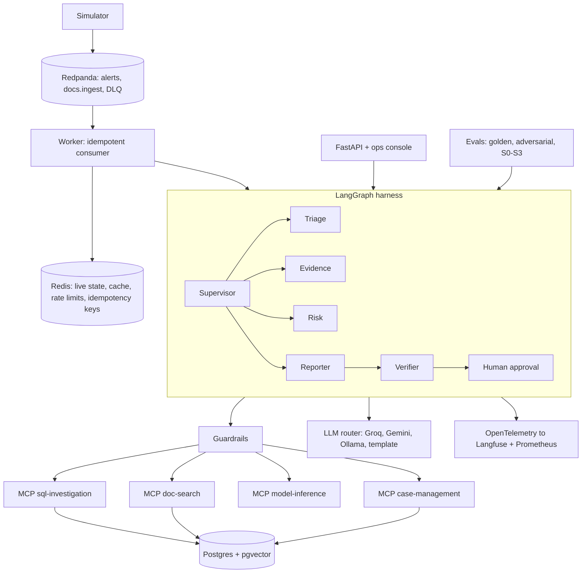

# Architecture — Agentic Sports Ops Platform

> Source: the strategy doc "Flagship AI Engineering Projects — Career Strategy & Blueprint" (sections 5–7).
> This file is the version Claude Code reads. Update it in the same PR as any change it describes.

## Problem
<!-- Rewrite in your own words (Day 1 task). Draft: -->
Risk models and rules raise more alerts than analysts can investigate, and every action on a
customer must be justified to a regulator. Analysts also lose time searching policies and past
incidents. The platform investigates alerts and answers policy questions with evidence, and a
human approves every consequential action.

Framing: regulated risk and compliance operations; a simulated sportsbook is the worked example.
The same design transfers to fintech fraud/AML, insurance claims and trust-and-safety.

## Users and use cases
- Risk / responsible-gambling analysts: investigate alerts, approve actions.
- Compliance reviewers: audit decisions. Team leads: queue health.
- Workflow A: investigate a streamed alert (stake escalation, bonus abuse, unusual market move,
  account takeover). Workflow B: answer a multi-document policy question with citations.

## Big picture

Process layout: one codebase, a few processes (API, worker, MCP servers) plus Postgres, Redis,
Redpanda. Not microservices.

## Key flows
**A. Alert investigation:** simulator publishes alert → worker dedupes on `alert_id`, updates Redis
→ graph starts (checkpointed) → evidence via SQL tools, risk score + SHAP via model tool, policy
passages via doc search → reporter drafts → verifier checks every claim has an evidence ID →
interrupt for human approval → action executed with idempotency key `case_id + action_type`.

**B. Policy research:** question → planner splits into sub-questions → hybrid search (BM25 + dense,
RRF) with metadata filters → cross-encoder rerank → token-budgeted context → answer with citations
→ verifier checks citations.

**C. Document ingestion:** file registered (doc_id = content hash) → queue → parser by type (text PDF,
scanned PDF/PNG via OCR, DOCX/HTML/email, XLSX/CSV as tables) → normalised elements with page and
section metadata → structure-aware chunks → PII redaction → batched embeddings → index.

## Components (why each exists)
| Component | Why | Without it |
|---|---|---|
| Simulator | Realistic data with planted ground truth | No objective evaluation |
| Redpanda | Durable, replayable event stream | Lost alerts in bursts |
| Worker | Long runs outside the request path | API timeouts |
| Redis | Live state, cache, rate limits, idempotency keys | Duplicates, 429 storms |
| LangGraph | State machine, checkpoints, interrupts | Unrecoverable runs |
| MCP servers | Typed, permissioned tool boundary | Tools tangled into prompts |
| Guardrails | Validation, permissions, budgets, injection checks | Unsafe or runaway agents |
| Postgres + pgvector | Data, cases, audit, checkpoints, vectors in one store | Extra systems to keep consistent |
| LLM router | Free-tier limits and outages are normal | Single point of failure |
| Langfuse + OTel | Trace every agent, tool and LLM call with cost | Debugging by guesswork |
| Evals | Golden, adversarial, baseline runs gate changes | Silent regressions |

## AI and ML design (summary)
- Agents: Supervisor, Triage, Evidence, Risk (calls the model; never an LLM opinion), Reporter, Verifier.
- Risk model: LightGBM on behavioural markers, calibrated, SHAP reasons, time-based splits.
- Numbers only from tools; refuse without evidence; human approval for any action.
- Prompts as versioned files; prompt version logged on every trace.
- Fallback: provider chain with circuit breakers → local model → evidence-only template.
- Later: Deep Agents for workflow B (week 6); QLoRA for alert classification + extraction (week 7).

## Non-functional targets
- Alert-to-draft p95 ≤ 60 s; zero unapproved actions; resume after crash without repeated side effects.
- No unmasked PII to external LLMs. Cost per case tracked and capped.

## Scale targets (assumptions unless cited)
| | Sportsbet tier | Junglee tier |
|---|---|---|
| Customers | ~2.4M (public job ad) | ~150M registered (company site) |
| Peak ingest | design for ~10K events/s | design for ~100K events/s |
| Alerts/day | ~6K | ~50–100K |
Consequences: rules + ML triage first, agents only on top-risk alerts; partition by account;
stateless workers; Redis sharding at Junglee tier; monthly table partitions; consumer lag as a key metric.

## Stack
Python 3.12, uv, FastAPI, Pydantic v2, LangGraph, MCP Python SDK, PostgreSQL 16 + pgvector,
Redis, Redpanda (aiokafka), LightGBM + SHAP, sentence-transformers (embeddings, cross-encoder),
OpenTelemetry + Langfuse, Prometheus + Grafana, Docker Compose, GitHub Actions.
Out until Phase 2: Kubernetes, managed AWS, Terraform, warehouse, SSO.
